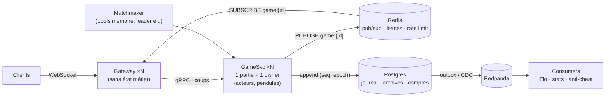

# De Postgres seul à l'échelle chess.com — notes d'architecture

> Notes issues d'une session d'architecture sur Gemline (juillet 2026), rédigées pour être relues avant un entretien système design. Code référencé : `internal/backplane/postgres.go`, `internal/server/store.go`, `internal/db/migrations/00010_game_events.sql`.

## Sommaire

1. [L'architecture actuelle](#1-larchitecture-actuelle--à-présenter-comme-des-choix)
2. [LISTEN/NOTIFY en 90 secondes](#2-listennotify-en-90-secondes)
3. [Pourquoi pas Kafka](#3-pourquoi-pas-kafka-à-cette-échelle)
4. [Les vraies limites de l'existant](#4-les-vraies-limites-de-lexistant--aucune-nest--en-forme-de-broker-)
5. [Les deux invariants qui changent tout](#5-les-deux-invariants-qui-changent-tout)
6. [L'architecture cible](#6-larchitecture-cible)
7. [Les arbitrages à assumer](#7-en-quoi-cest--mieux---réponse-en-trois-colonnes)
8. [Migration en 5 étapes](#8-migration-en-5-étapes)
9. [Questions pièges & réponses courtes](#9-questions-pièges--réponses-courtes)
10. [Vocabulaire & références](#10-vocabulaire--références)

---

## 1. L'architecture actuelle — à présenter comme des choix

Jeu de plateau multijoueur temps réel (2–6 joueurs). Monolithe Go + React, **Postgres est la seule infrastructure** — il joue quatre rôles à la fois :

- **Journal d'événements durable** — table `game_events(game_id, seq, type, payload)`, append-only, `seq` monotone par partie alloué sous le verrou de la ligne `games`. C'est de l'event sourcing : l'état d'une partie est reconstructible par replay.
- **Bus pub/sub inter-pods** — backplane `LISTEN/NOTIFY`, 2 canaux globaux. Permet 2+ replicas sans sessions sticky : n'importe quel pod traite n'importe quelle requête, cohérence par invalidation de cache.
- **File de matchmaking** — table + `FOR UPDATE SKIP LOCKED` : chaque pod tire des lots disjoints sans coordination (pattern *competing consumers* sans broker).
- **Offsets consommateurs** — rattrapage client via `GET /events?since=N` après un trou de `seq`.

> **Le contrat central :** le bus est *lossy by design* ; la vérité est dans le journal. Les événements sont numérotés, le client détecte un trou de `seq` et rattrape depuis le store canonique. Ce contrat survit à tous les changements de transport — c'est la meilleure décision du projet.

## 2. LISTEN/NOTIFY en 90 secondes

Pub/sub natif de Postgres : une session s'abonne (`LISTEN canal`), n'importe quelle autre publie (`NOTIFY` / `pg_notify(canal, payload)`). Les cinq points à connaître :

- **Transactionnel** — la notification part au `COMMIT`, jamais sur rollback. Écrire l'événement + notifier dans la même transaction = cohérence gratuite (pas de dual-write).
- **Session-scoped** — `LISTEN` est un état de session : il faut une connexion dédiée longue durée hors pool. `NOTIFY` passe par le pool (simple requête sans état).
- **Asynchrone** — le message arrive sur la socket hors cycle requête/réponse (`WaitForNotification` côté pgx).
- **At-most-once** — abonné déconnecté = message perdu définitivement. Pas de rétention, pas de replay, payload ≤ ~8 Ko (on transporte des identifiants, pas des données).
- **Un seul flux par pod** — tout transite par l'unique connexion listener, handlers séquentiels. C'est le point qui ne scale pas.

## 3. Pourquoi pas Kafka (à cette échelle)

Le projet possède déjà, implémenté sur Postgres, les quatre propriétés qu'un broker apporterait : log ordonné durable, offsets de rattrapage, pub/sub inter-instances, distribution de travail concurrente. À 2 pods de 50m CPU sur un nœud 2 vCPU, un cluster Kafka serait **plus lourd à opérer que l'application entière**, et introduirait un second système de vérité à réconcilier avec la base (problème du dual-write) là où aujourd'hui écriture et notification partent du même chemin transactionnel.

Kafka devient pertinent sur trois signaux : **fan-out massif** (milliers de spectateurs par partie), **N consommateurs découplés** (anti-triche, analytics, projections — chacun à son rythme avec ses offsets), **volume d'écriture** dépassant une instance Postgres. Aucun n'est atteint.

> « Postgres-as-broker est un pattern reconnu et défendable ; la table `game_events` est déjà l'interface naturelle pour brancher un CDC le jour où le besoin streaming émerge. La migration future est facile précisément parce que le design actuel est propre. »

## 4. Les vraies limites de l'existant — aucune n'est « en forme de broker »

- **Timers non coordonnés** (le vrai bug) — pendules, forfait sur déconnexion (60 s), coups de bots sont des `time.Timer` locaux à chaque pod. Deux pods peuvent armer un timer pour la même partie ; un redémarrage perd les timers en vol. Problème de *correction*, pas de charge.
- **Rate limiting per-pod** — limite effective = limite configurée × nombre de replicas.
- **Broadcast global** — 2 canaux pour tout le site : chaque pod reçoit et filtre 100 % du trafic d'événements, même sans client concerné. Coût par pod proportionnel au trafic *global*, pas au trafic *local*.
- **Cohérence par invalidation** — personne ne fait confiance à sa mémoire : un aller-retour Postgres par coup et par pod pour recharger le cache.

Ces problèmes appellent un *lease distribué* et un état partagé léger — pas une plateforme de streaming.

## 5. Les deux invariants qui changent tout

### ① Un écrivain unique par partie (affinité partie → processus)

Modèle acteur : chaque partie live est possédée par exactement un processus, qui tient l'état en mémoire (sa mémoire *est* la vérité live), traite les coups séquentiellement (`seq++` local, plus de verrou base pour sérialiser), et est l'unique autorité temporelle (un timer = un propriétaire = zéro doublon). Résout d'un coup : état chaud, timers, cohérence.

Mécanique : **leases** avec heartbeat (annuaire Redis ou advisory locks Postgres), **fencing tokens** (époque croissante incluse dans chaque écriture — un propriétaire zombie est rejeté par le journal), **reprise par replay** depuis `game_events` au crash.

### ② Un fan-out routé par intérêt

Un canal par partie (`game:{id}`) au lieu de canaux globaux. Les abonnements suivent l'audience : un gateway s'abonne quand son premier client ouvre la partie, se désabonne au départ du dernier. Le coût de chaque nœud devient proportionnel à ce que *ses* clients regardent — c'est ce qui rend le fan-out horizontal.

> **Petite vs grande échelle :** à petite échelle, les deux invariants sont largement *substituables* — l'affinité poussée jusqu'aux connexions WS (routage sticky par `gameId`) rend le bus quasi inutile ; inversement, un transport routé compense l'absence d'affinité. À grande échelle, connexions et état de jeu doivent vivre sur des machines différentes — et le pub/sub routé est le pont entre les deux. On finit par faire les deux.

> « L'affinité donne un écrivain unique par partie, le routage par canal donne des lecteurs ciblés par partie. Ensemble, ils transforment le coût d'un coup de O(pods) en un hop + une publication aux seuls intéressés. »

## 6. L'architecture cible

Le pub/sub Redis est le chemin rapide et lossy ; la vérité reste le journal Postgres.

### Rôle de chaque composant — et pourquoi il existe

| Composant | Rôle | Raison d'exister |
| --------- | ---- | ---------------- |
| **Gateway** | Termine les WS, auth, présence ; forwarde les commandes au propriétaire ; pousse les événements reçus de Redis | Les connexions survivent aux déploiements de la logique ; multiplexe N parties sur 1 connexion client |
| **GameSvc** | Acteur par partie : état mémoire, validation, seq, pendules, bots ; append au journal | Écrivain unique — élimine structurellement les courses et timers dupliqués |
| **Redis** | ① pub/sub `game:{id}` ② annuaire des leases ③ rate limit partagé | Découplage : l'émetteur publie sans connaître les abonnés ; nettoyage automatique des abonnements ; churn d'abonnements que LISTEN/NOTIFY ne sait pas faire |
| **Postgres** | Journal `game_events`, archives, comptes, Elo | Recentré sur ce qu'il fait bien : durabilité — plus de rôle de bus ni de point de synchro par coup |
| **Matchmaker** | Pools en mémoire par taille/bande Elo, appariement événementiel, un seul actif (leader élu) | Latence d'appariement = KPI produit ; snapshot Redis pour la reprise |
| **Redpanda** | Log durable alimenté par outbox/CDC depuis `game_events`, topic partitionné par `gameId` | N consommateurs découplés à leur rythme (Elo, stats, anti-triche) — compatible API Kafka, binaire unique |

### Cycle de vie d'un coup

1. Le joueur envoie son coup en WebSocket à son gateway.
2. Le gateway lit `lease:game:X` dans Redis et forwarde en gRPC au GameSvc propriétaire.
3. Le propriétaire valide en mémoire, incrémente `seq`, appende au journal (avec l'époque du lease), réarme la pendule.
4. Il publie l'événement sur `game:X`.
5. Seuls les gateways abonnés le reçoivent et le poussent aux WS concernés — y compris l'auteur du coup, confirmé par le même chemin que les autres.
6. Trou de `seq` côté client → rattrapage `?since=N`. Inchangé depuis le monolithe.

> **Sens du trafic :** Redis ne sert que dans le sens descendant (événements → clients). Un coup est de la requête/réponse vers exactement un destinataire — il passe en gRPC direct, pas en pub/sub.

## 7. En quoi c'est « mieux » — réponse en trois colonnes

| Mieux dès aujourd'hui (correction) | Mieux seulement à l'échelle | Franchement pire |
| ---------------------------------- | --------------------------- | ---------------- |
| Timers uniques (fin des doubles forfaits) · rate limit exact · déployer la logique sans couper une seule connexion WS | Fan-out proportionnel à l'audience · scaling indépendant connexions/CPU · isolation des pannes · consumers analytiques | Surface opérationnelle ×6 · pannes distribuées inédites (lease expiré pendant un GC, partition réseau) · latence en hops · boucle de dev alourdie |

> « Les gains viennent des invariants, pas du nombre de services. Le nombre de services, c'est de l'emballage — la réponse à "qui déploie quoi indépendamment", une question d'organisation plus que de technique. »

Preuve par Lichess : ~5M parties/jour sur un quasi-monolithe Scala (`lila`) + un serveur WS dédié (`lila-ws`) reliés par Redis pub/sub, MongoDB, une équipe minuscule. Les bons invariants dans peu de processus battent les microservices sans invariants.

### Unifier gateway + GameSvc ? (l'objection légitime)

Possible, et Redis disparaît presque : routage sticky des WS par `gameId` → tous les clients d'une partie sont sur le pod propriétaire → hub local suffisant. Trois limites font éclater ce modèle en grandissant : **les connexions meurent avec le code** à chaque déploiement ; **une partie chaude** concentre tous ses spectateurs sur une machine ; **un client multi-parties** (lobby live, mode TV) exigerait une connexion par partie. Redis est le prix de la *liberté de placement des connexions*.

## 8. Migration en 5 étapes

Chacune déployable seule, chacune enseigne un concept :

1. **Affinité dans le binaire actuel** — leases + fencing + forward gRPC entre les pods existants. Règle le bug des timers. *Concepts : leases, fencing, split-brain.*
2. **Fan-out Redis `game:{id}`** — retire LISTEN/NOTIFY du chemin des parties. *Concepts : pub/sub routé, refcounting d'abonnements.*
3. **Split Gateway / GameSvc** — deux binaires, drain sans couper les WS. *Concepts : graceful handoff, séparation connexion/logique.*
4. **Matchmaker dédié** — pools mémoire, snapshot, leader élu. *Concept : élection de leader.*
5. **Redpanda + outbox + consumers** — Elo/stats/anti-triche en asynchrone. *Concepts : outbox/CDC, partitionnement, consumer groups, idempotence.*

Ce qui ne change jamais : le moteur de règles pur, le protocole client (`seq`, catch-up, seat tokens), le schéma du journal, le replay, et le principe « transport lossy, vérité dans le journal ».

## 9. Questions pièges & réponses courtes

**Q — Pourquoi ne pas avoir mis Kafka dès le début ?**
Parce que j'avais déjà ses quatre propriétés sur Postgres (log ordonné, offsets, pub/sub, competing consumers), avec en bonus la transactionnalité écriture+notification que Kafka ne donne pas sans outbox. Kafka aurait été plus lourd à opérer que l'application, pour zéro propriété nouvelle.

**Q — À quoi sert Redis exactement dans la cible ?**
C'est le registre d'intérêt clé en main : le propriétaire publie sur `game:X` sans savoir qui écoute, les gateways s'abonnent selon leurs clients, le nettoyage est automatique à la déconnexion. Sans lui, il faudrait construire soi-même ce registre (inscriptions, désinscriptions, gateways morts, streams gRPC N×M). Rôles annexes : annuaire de leases, rate limit partagé.

**Q — Que se passe-t-il si Redis perd un message ?**
Rien de grave, par design : le client voit un trou dans les `seq` et rattrape via `?since=N` sur le journal. Vitesse par Redis, vérité par Postgres — le même contrat que LISTEN/NOTIFY avant lui.

**Q — Comment évitez-vous deux propriétaires pour la même partie ?**
Lease avec TTL + heartbeat pour le cas nominal, et fencing token pour le cas dégradé : chaque lease porte une époque croissante, chaque append au journal l'inclut, et une écriture d'époque périmée est rejetée par une contrainte. Un propriétaire zombie (pause GC, partition) peut croire posséder la partie — il ne peut plus rien écrire.

**Q — Le propriétaire d'une partie crashe : que perd-on ?**
Rien de durable. Le journal contient tous les événements ; le nouveau propriétaire rejoue, recalcule la pendule depuis les timestamps persistés, réarme les timers. On perd quelques secondes de latence, pas d'état.

**Q — Pourquoi pas un topic Kafka par partie ?**
Des millions de topics éphémères sont un anti-pattern Kafka (coût de métadonnées et de fichiers par topic). Le fan-out live veut des canaux jetables à churn rapide — Redis pub/sub ou NATS. Kafka/Redpanda reste en aval, un seul topic partitionné par `gameId`, pour les consommateurs durables.

**Q — Pourquoi séparer le gateway de la logique de jeu ?**
Trois raisons : déployer la logique dix fois par jour sans couper une connexion ; répartir les 50 000 spectateurs d'une partie chaude sur N machines alors que l'écriture reste sur une ; une seule connexion par client quel que soit le nombre de parties regardées.

**Q — N'est-ce pas sur-architecturé pour votre trafic ?**
Si, et je l'assume : pour le produit tel qu'il est, le monolithe actuel est supérieur — moins de pièces, moins de modes de panne. La cible se justifie par les bugs de correction qu'elle élimine (timers) et par l'objectif d'apprentissage. Je sais dire lequel des deux déployer selon le contexte — c'est ça, la compétence.

## 10 bis. Ce qui a été construit (PR #44, mergée) — brique par brique

| # | Brique | Concept | Code |
| - | ------ | ------- | ---- |
| 1 | Lease par partie | Verrou qui expire ; heartbeat = preuve de vie ; horloge DB unique | `internal/lease/lease.go`, migration `00017` |
| 2 | Fencing token | L'epoch avance à chaque changement de main ; check-and-write atomique sous le verrou de ligne — un zombie peut croire, pas agir | `AppendEvent`/`UpdateOutcome` (`repo_postgres.go`), migrations `00018`/`00019` |
| 3 | Forward vers le propriétaire | Annuaire éventuellement cohérent + routage best-effort ; tout échec dégrade vers l'ancien comportement (sérialisation DB, epoch 0) | `internal/server/forward.go`, listener interne (tag en contexte, pas en header) |
| 4 | Devoirs owner-only + adoption | Un écrivain unique = un seul jeu de timers ; adoption par trafic, invalidation, ou sweeper d'orphelines (10 s) ; `onLost` = se retirer | gates dans `armClock`/`maybeScheduleBot`, `AdoptGame`, `StartOrphanSweeper` |
| 5 | Bus routé par intérêt | Canaux `game:{id}` ; abonnements refcountés (cache + spectateurs WS) ; lossy assumé, vérité au journal, rattrapage par `seq` | `internal/bus/redis.go`, hooks Hub/Store |
| 6 | Split gateway/gamesvc | Plan des connexions ≠ plan de la logique ; un binaire, `ROLE=all\|gateway\|gamesvc` (pattern Loki/Mimir) ; le Service k8s comme discovery du pool | `forwardOnly` + `lease.Resolver`, manifests `deploy/k8s/` |
| 7 | Élection de leader | Une ligne `leader_leases` ; candidater = renouveler (même upsert) ; le workload vit dans le contexte de leadership ; démission ≠ crash | `internal/lease/elector.go`, migration `00020` |
| 8 | Doorbell matchmaking | Chemin de latence (wake pub/sub) + chemin de correction (ticker fallback) ; la file reste durable en Postgres | canal `matchmake`, `WakeMatcher` |

Principes transverses, à réciter : (1) *le routage a le droit de se tromper, l'écriture non* ; (2) *epoch 0 = chemin dégradé volontaire, sérialisé par la base comme avant* ; (3) *le bus est lossy, le journal est la vérité, le client rattrape par offset* ; (4) *le protocole client n'a jamais changé* — snapshot + flux + catch-up, d'où zéro modification frontend.

## 10. Vocabulaire & références

- **Lease + fencing token** — Kleppmann, « How to do distributed locking » (la critique de Redlock) ; chap. 8–9 de *Designing Data-Intensive Applications*.
- **Event sourcing / replay** — l'état est une fonction du journal ; `game_events` + `replay.go` en sont l'implémentation.
- **Pattern outbox / CDC** — publier vers un broker *depuis* la transaction base (table outbox relayée, ou Debezium) pour éviter le dual-write.
- **`FOR UPDATE SKIP LOCKED`** — file de travail concurrente en SQL pur, le « job queue Postgres » standard.
- **Modèle acteur** — Erlang/OTP, Akka, Orleans (virtual actors) ; en Go : une goroutine + mailbox par entité.
- **Lichess** — `lila` (monolithe Scala) + `lila-ws` reliés par Redis pub/sub : la preuve open source que les invariants comptent plus que le nombre de services.
- **At-most-once vs at-least-once** — LISTEN/NOTIFY et Redis pub/sub sont at-most-once ; Kafka/Redpanda at-least-once (d'où l'idempotence des consumers).
